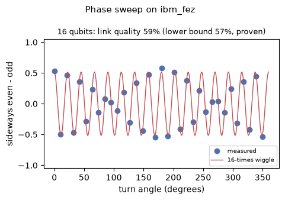

# quantum-by-building

**Seven reproducible Python/Qiskit experiments on simulators and real IBM quantum hardware.
The strongest result verified entanglement across 16 qubits, on two different IBM machines:
cautious lower fidelity bounds of 53.4% and 57.1%, both above the 50% threshold that proves
it** ([lesson 7](lessons/07_linking_many/)).

*Scope:* a repeat on the first machine's same 16 qubits, the next morning after IBM
recalibrated it, fell short (46.9%). The 57.1% result came from fresh qubits chosen from that
day's calibration before the run. The measured counts behind every bound are in
[`lessons/07_linking_many/data`](lessons/07_linking_many/data/), and
[`recompute.py`](lessons/07_linking_many/recompute.py) recalculates them without an IBM account.



I learned quantum computing the way I learned Salesforce and Postgres: by building small,
working things and writing down what each one taught me. Every experiment here is a small
Python script using [Qiskit](https://www.ibm.com/quantum/qiskit), IBM's open-source quantum
SDK, and every one:

1. starts with a **plain-English analogy** for the quantum idea, before any code,
2. runs on a **local simulator** (free and instant) and **checks itself** (`CHECK PASSED`),
3. then runs on a **real IBM quantum computer** through IBM's free Open Plan, and reports the
   noisy real-world results next to the perfect simulated ones, including the runs that failed.

## Quickstart

Tested with **Python 3.14.3**, Qiskit 2.6.2, qiskit-aer 0.18.4, qiskit-ibm-runtime 0.52.1,
NumPy 2.5.5 and Matplotlib 3.11.2 (`requirements.txt` allows newer minor versions).

```bash
python3 -m venv .venv && source .venv/bin/activate   # Windows Git Bash: source .venv/Scripts/activate
pip install -r requirements.txt
python lessons/01_bell_state/bell.py
```

To run on real IBM hardware, see [HARDWARE.md](HARDWARE.md). Your IBM API key is saved in
your home folder, never in this repo.

## Lessons

| # | Lesson | Quantum idea | Result on real hardware |
|---|---|---|---|
| 1 | [Two magic coins](lessons/01_bell_state/) | Entanglement (Bell state) | 91.7% / 96.4% matching (ibm_marrakesh) |
| 2 | [Quantum dice](lessons/02_quantum_dice/) | Superposition and measurement | Genuinely random but slightly loaded (ibm_marrakesh) |
| 3 | [Cancelling waves](lessons/03_interference/) | Interference | 99.8% / 99.4%, matching the theory curve (ibm_marrakesh) |
| 4 | [Guess the secret number in one try](lessons/04_secret_number/) | Bernstein–Vazirani | 91.6% from one question (ibm_fez) |
| 5 | [Find the prize](lessons/05_grover_search/) | Grover's search | 78.5% vs 12.5% blind guessing, 8 boxes (ibm_fez) |
| 6 | [Real machines are noisy](lessons/06_noise/) | Noise and error mitigation | Twirling kept a link provable after 160 extra gates (ibm_fez) |
| 7 | [How many qubits can we link?](lessons/07_linking_many/) | GHZ states, entanglement witnesses | **16 qubits linked**, on two machines (ibm_marrakesh, ibm_fez) |

## What went wrong, and how it was caught

The misses taught as much as the successes, so they stay in the write-ups:

- **Inspecting the compiled circuits exposed invalid comparisons.** In lesson 7, each
  "straight" and "sideways" measurement pair has to run on the same physical qubits to mean
  anything. Reading back the exact circuits IBM ran showed that, for three group sizes, the
  compiler had put the two halves on different qubits. Those results were voided. The script
  now pins each pair and checks every job automatically.
- **The compiler deleted the experiment.** In lesson 3, IBM's compiler noticed that two
  "spin" gates cancel and removed both, so the chip never did the interference being tested.
  The fix (barriers between stages) is now a standing rule for every lesson.
- **Statistics that were too generous.** Lesson 7's first "proof" rule would have certified an
  unlinked state 13.5% of the time in the hardest case. A fit-aware bound brought that to 1.9%
  ([`false_positive_sim.py`](lessons/07_linking_many/false_positive_sim.py), seeded and
  rerunnable), and the 16-qubit result still passed.
- **Published calibration can be wrong.** One qubit IBM listed at 0.4% readout error gave the
  wrong answer about 42% of the time. A piece-by-piece diagnostic found it.
- **Results drift.** A same-qubit repeat of the first 16-qubit run, taken after an overnight
  recalibration, fell just short. A fresh run on that day's best qubits proved it again.

Each lesson's README has the details, and the dated output behind every number.

The roadmap and the rules for building each lesson are in [PLAN-qiskit.md](PLAN-qiskit.md).

## Credits

Patrick Hewitt, with Claude (Anthropic) and ChatGPT (OpenAI).
