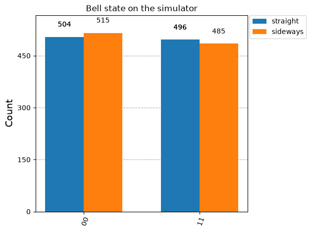
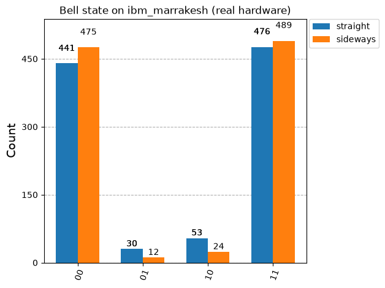

# Lesson 1: Two magic coins (the Bell state)

## The idea, before any code

Picture two coins. You flip both and catch them. Normal coins land independently, so you
get all four combos (heads-heads, heads-tails, tails-heads, tails-tails) about equally.

Now picture two **magic coins** that are linked. Each one on its own is a fair 50/50 flip,
but they *always* land the same way: both heads or both tails, never mixed. That link is
called **entanglement**, and this pair is called a **Bell state**. It's the "hello world"
of quantum computing.

**Catch:** matching alone doesn't prove anything quantum. Two sealed envelopes, each
holding a copy of the same random coin flip, also "always match". The quantum part shows
up when you look at the coins **from a different angle** (turn both sideways before
looking). Envelope coins stop agreeing. Magic coins keep agreeing. So this lesson runs
the experiment both ways.

Three words to know:

| Word | Plain meaning |
|---|---|
| **Qubit** | A quantum coin. Before you look it can be "in the air", a mix of 0 and 1. |
| **Gate** | An instruction that changes the qubits, like "flip it" or "tie these two together". |
| **Measure** | Catch the coin and look. The mix collapses to a plain 0 or 1. |

## The code

[`bell.py`](bell.py) builds the circuit in three steps:

1. `qc.h(0)`, the **Hadamard gate**, throws qubit 0 into the air: 50% 0, 50% 1.
2. `qc.cx(0, 1)`, the **CNOT gate** ("controlled NOT"), says "if qubit 0 is 1, flip qubit 1".
   Because qubit 0 is still in the air, this ties the two together instead of picking one answer.
3. `qc.measure(...)` catches both and writes the results down.

```
     ┌───┐     ┌─┐
q_0: ┤ H ├──■──┤M├───
     └───┘┌─┴─┐└╥┘┌─┐
q_1: ─────┤ X ├─╫─┤M├
          └───┘ ║ └╥┘
c: 2/═══════════╩══╩═
```

Read it left to right like sheet music: each line is one qubit, each box is a gate.

The **sideways** version adds one more Hadamard on *each* qubit right before measuring.
That's "turning both coins sideways before looking":

```
     ┌───┐     ┌───┐┌─┐
q_0: ┤ H ├──■──┤ H ├┤M├───
     └───┘┌─┴─┐├───┤└╥┘┌─┐
q_1: ─────┤ X ├┤ H ├─╫─┤M├
          └───┘└───┘ ║ └╥┘
c: 2/════════════════╩══╩═
```

## What happened when we ran it

On the local simulator (2026-11-26, 1000 runs each, fixed seed so it's repeatable):

```
[straight] {'00': 504, '11': 496}
[sideways] {'00': 515, '11': 485}
CHECK PASSED
```



For comparison, "sealed envelope" coins (a plain random 00 or 11, decided up front)
measured sideways gave `{'00': 255, '01': 252, '10': 247, '11': 246}`. All four combos
showed up, so they no longer agree.

What that means:

- **Straight: only `00` and `11`.** The coins matched every time, but envelopes could do that.
- **Sideways: still only `00` and `11`.** The envelope coins fell apart here and the magic
  coins didn't. That's the fingerprint of entanglement: the pair agrees from more than one angle.
- **About half and half.** Each coin alone is still a fair flip. You can't predict *which*
  way they'll land, only that they'll agree.
- **Why not exactly 500/500?** Same reason 1000 real coin flips rarely give exactly 500 heads.
  It's chance, and these are well within normal.

(The airtight proof that *no* pre-arranged trick can copy this tilts the two coins to
different in-between angles and counts how often they agree. It's called a Bell test,
and it won the 2022 Nobel Prize in Physics. Straight and sideways are enough to see the idea.)

### On a real quantum computer

IBM's **ibm_marrakesh**, 2026-11-26, 1000 runs each (took under a minute, including the queue):

```
straight: 11: 476   00: 441   10: 53   01: 30    -> coins matched 91.7%
sideways: 11: 489   00: 475   10: 24   01: 12    -> coins matched 96.4%
```



- **Still mostly `00` and `11`, both ways.** The entanglement survived on real hardware, and
  sideways it was far above the ~50% agreement that pre-arranged coins would give.
- **But 4–8% mismatches showed up.** The simulator had zero. Real qubits are tiny, fragile
  physical things: heat, stray signals and imperfect gates knock some runs off course.
  This is called **noise**, and fighting it is most of what quantum engineering is about
  today. Lesson 6 digs into it.
- **Both versions pass** the hardware check (at least 90% matching).

## How we know it works

The script checks itself and prints `CHECK PASSED` (exit code 0) only if:

- on the simulator, mismatches (`01` or `10`) are **zero** in *both* versions, and
- `00` is between 40% and 60% of the matches in each.

On real hardware the check relaxes to "at least 90% match", because real qubits are noisy.
That noise is the subject of lesson 6.

## Run it on a real quantum computer yourself

See [HARDWARE.md](../../HARDWARE.md). The short version, once your account is saved:

```bash
python lessons/01_bell_state/bell.py --ibm
python tools/get_job.py <job-id>
```

Circuit 1 is straight, circuit 2 is sideways. Expect a few percent of `01` and `10` on
real hardware. That's the machine's noise showing up, not a bug in the code.
