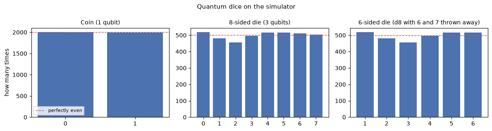
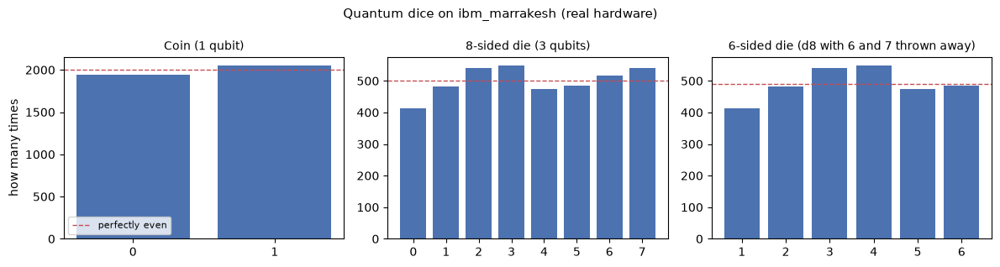

# Lesson 2: Quantum dice (superposition and measurement)

## The idea, before any code

Flip a coin and freeze the moment it's **spinning in the air**. Is it heads or tails?
Neither yet. It's a blur of both. Only when you catch it and look does it become one or the other.

A qubit can be put into that "spinning" state for real. It's called **superposition**:
the qubit is partly 0 and partly 1 at the same time. When you **measure** it (catch it and
look), it snaps to a plain 0 or 1, at random, with odds set by how it was spinning.

One big difference from a real coin: a real coin's landing is decided by physics you
*could* in principle predict (how hard you flipped it, the air, the table). A qubit's
answer is different. Standard quantum mechanics says nothing hidden decides it, and
experiments (Bell tests, the same idea as lesson 1's sideways check) have ruled out the
simplest kinds of hidden explanation. As far as anyone can tell, it's random all the way
down. That makes qubits a good source of genuinely unpredictable numbers.

Then we build dice out of coins:

- **1 qubit** = a coin (2 sides: 0 or 1)
- **3 qubits** = three coins side by side = a 3-digit binary number = an **8-sided die** (0 to 7)
- **A 6-sided die** = roll the 8-sided die and **throw away 6 and 7**, then count 0–5 as 1–6.
  If the d8 is fair, every face stays equally likely. (Throwing rolls away can't fix a
  loaded d8, though. The d6 inherits any lean, as the hardware run below shows.)

New words:

| Word | Plain meaning |
|---|---|
| **Superposition** | The "spinning coin" state: partly 0 and partly 1 until measured. |
| **Shot** | One run of the circuit, start to finish. 4000 shots = 4000 tosses. |
| **Binary** | Counting with only 0s and 1s. Three bits make 8 numbers: `000`=0 up to `111`=7. |

## The code

[`dice.py`](dice.py) has two tiny circuits.

**The coin**: one Hadamard gate (the "spin it" instruction from lesson 1), then measure.

```
     ┌───┐┌─┐
  q: ┤ H ├┤M├
     └───┘└╥┘
c: 1/══════╩═
```

**The 8-sided die**: the same thing on three qubits at once.

```
     ┌───┐┌─┐
q_0: ┤ H ├┤M├──────
     ├───┤└╥┘┌─┐
q_1: ┤ H ├─╫─┤M├───
     ├───┤ ║ └╥┘┌─┐
q_2: ┤ H ├─╫──╫─┤M├
     └───┘ ║  ║ └╥┘
c: 3/══════╩══╩══╩═
```

Unlike lesson 1, these qubits aren't linked. Each one is its own independent coin.

The 6-sided die needs no new circuit. `d6_from_d8()` takes the 8-sided rolls, drops the
6s and 7s in ordinary Python, and adds 1 to the rest.

## What happened when we ran it

### On the simulator

2026-11-26, 4000 shots each:

```
first 20 coin tosses: 1 1 1 1 0 1 1 1 0 1 1 0 0 0 0 1 0 0 1 1
first 20 d6 rolls:    1 6 1 5 1 5 3 4 4 1 5 1 1 3 2 5 1 5 5 2
coin: {0: 2004, 1: 1996}
d8:   {0: 519, 1: 482, 2: 456, 3: 496, 4: 517, 5: 515, 6: 512, 7: 503}
d6:   {1: 519, 2: 482, 3: 456, 4: 496, 5: 517, 6: 515}  (kept 2985 of 4000 d8 rolls, 75%)
CHECK PASSED
```



- **Every face came up about equally.** Each d8 face was 11–13% (perfect would be 12.5%).
- **About 75% of d8 rolls were kept for the d6.** That's expected: 6 of the 8 faces are kept.
- **Notice "four 1s in a row" at the start.** Real randomness has streaks. A sequence with
  no streaks at all would actually be suspicious.

**A twist: the simulator's randomness is fake.** It's an ordinary computer pretending, using
a formula seeded with the number 2026. Run it again and you get the *exact same* rolls.
That's handy for checking the lesson, but it's not quantum randomness. For that you need
a real quantum device.

### On a real quantum computer

IBM's **ibm_marrakesh**, 2026-11-26, 4000 shots each:

```
coin: {0: 1947, 1: 2053}
d8:   {0: 413, 1: 482, 2: 540, 3: 549, 4: 474, 5: 485, 6: 517, 7: 540}
d6:   {1: 413, 2: 482, 3: 540, 4: 549, 5: 474, 6: 485}  (kept 2943 of 4000)
```



- **This randomness comes from a quantum measurement, not a formula.** Run it again and
  you'd get different rolls; unlike the simulator, there's no seed that reproduces them.
- **But the die is slightly loaded.** `0` came up 10.3% and `3` came up 13.7%, where a
  fair die gives 12.5%. Is that just bad luck? A standard statistics test (chi-square)
  says a fair die would look this lopsided only about **1 time in 8,000**. So the measured
  rolls are biased. Most of the lean shows up in one bit, which came out 1 about 54% of the
  time instead of 50%. All three bits leaned slightly toward 1, which is why `000` came up
  least. This test measures the bias; it doesn't identify the cause. The "spin" step (the
  H gate) and the measuring step are both possible sources, and nothing here tells them apart.
- **So: simulator = even but fake; hardware = real but a bit uneven.** Companies that sell
  quantum random numbers run the raw bits through a mathematical "evener-outer" (called
  *randomness extraction*) that squeezes many slightly loaded bits into fewer, almost
  perfectly even ones. That's a possible follow-up.
- **It still passes** the looser hardware check (every d8 face within 7–18%, every d6 face
  within 10–24%).

## How we know it works

The script prints `CHECK PASSED` (exit code 0) only if, on the simulator:

- the coin lands each way 45–55% of the time,
- every d8 face is 9–16%,
- every d6 face is 12–22% and nothing outside 1–6 ever shows up.

With 4000 shots those ranges are wide enough that a fair die essentially never fails by
chance, and narrow enough to catch a broken die (though not a slightly loaded one). Real hardware gets wider limits
(coin 40–60%, d8 7–18%, d6 10–24%).

## Run it on a real quantum computer yourself

See [HARDWARE.md](../../HARDWARE.md). Once your account is saved:

```bash
python lessons/02_quantum_dice/dice.py --ibm
python tools/get_job.py <job-id>
```

Circuit 1 is the coin. Circuit 2 is the d8, shown as 3-digit binary (`011` = 3).
