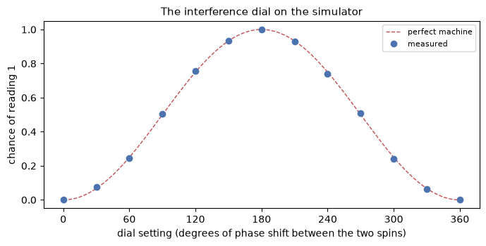
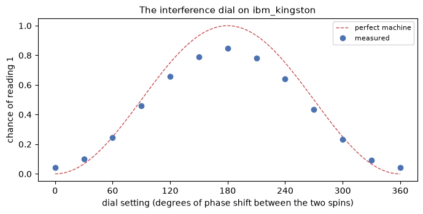
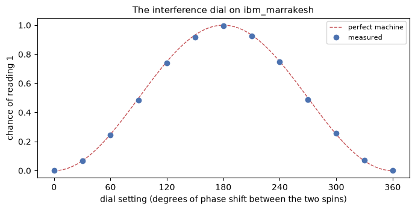

# Lesson 3: Cancelling waves (interference)

## The idea, before any code

**Noise-cancelling headphones** work by listening to the noise around you and playing the
same sound wave **flipped upside down**. Where the noise wave goes up, the headphone wave
goes down. Added together they cancel, and you hear silence.

Qubits do the same thing with **possibilities**. Each possibility, 0 and 1, carries a
wave-like number called an **amplitude**, and amplitudes can add up *or cancel out*, unlike
ordinary odds. That's **interference**. It's a key ingredient in the famous quantum
algorithms (like Grover's search and Shor's factoring): arrange things so the wrong answers
cancel and the right answer gets louder.

Here's the surprise this lesson shows. Spin a normal coin, then spin it again: still 50/50,
obviously. Spin a qubit, then spin it again: it comes back to **0 every time**. The two
routes that lead to "1" cancel each other out, like the noise and the anti-noise.

Three experiments plus a dial:

1. **Spin, spin**: comes back 0. The routes to 1 cancel.
2. **Spin, flip the wave, spin**: a Z gate in the middle flips one route upside down.
   Now the routes to **0** cancel instead, and it comes back **1** every time.
3. **Spin, peek, spin**: look at the qubit halfway. Peeking forces it to pick 0 or 1, so
   there's only one route left and nothing to cancel against. The answer becomes a plain
   coin flip. *Measuring changes the outcome.* No person is needed: anything that records
   which way the qubit went destroys the cancelling.
4. **The dial**: instead of fully flipping the wave, shift it by a few degrees, like
   playing the anti-noise slightly out of sync. You get partial cancelling, and as you
   turn the dial the odds sweep smoothly from 0% to 100% and back.

New words:

| Word | Plain meaning |
|---|---|
| **Amplitude** | The wave-like number each possibility carries. Its size sets the odds; its phase decides what cancels. |
| **Interference** | Amplitudes adding up or cancelling out, like waves. |
| **Phase** | Where a wave is in its up-and-down cycle. Shifting the phase 180° flips it upside down. |
| **Z gate** | Flips the phase of the "1" part of the qubit by 180°. Doesn't change the odds by itself. |

## The code

[`interference.py`](interference.py) builds all four. Each is only a few gates:

```
spin-spin:      ┤ H ├┤ H ├┤M├
spin-Z-spin:    ┤ H ├┤ Z ├┤ H ├┤M├
peek:           ┤ H ├┤M├┤ H ├┤M├
dial:           ┤ H ├┤ P(angle) ├┤ H ├┤M├
```

- `H` is the "spin" (Hadamard) gate from lessons 1 and 2.
- `Z` flips the phase. On its own it would change nothing you could see, which makes it
  a good demonstration that phase only shows up through interference.
- `P(angle)` is the dial, a **phase gate** that shifts the phase by any angle.
  `P(180°)` is the same as `Z`. The script tries 13 settings from 0° to 360°.
- The peek circuit has two measurements: the peek, and the final answer.
- **The barriers** (the shaded ░ columns in the drawings the script prints, left out above) matter on real hardware.
  Before running, the circuit is compiled for the chip, and the compiler is smart: it spots
  that H followed by H does nothing and **deletes both**. The chip would then just read a
  qubit that never moved. A barrier says "don't merge gates across this line", so the real
  qubit has to do the cancelling itself. (Our first hardware run didn't have them, and a
  review caught it. That run is thrown out.)

## What happened when we ran it

### On the simulator

2026-11-26, 4000 shots each (summary of the script's output):

```
spin-spin    -> 0 came back 100.0% of the time
spin-Z-spin  -> 1 came back 100.0% of the time
peek         -> final answer 0 was 51.4% (a coin flip)
dial         -> biggest gap from the perfect curve: 1.1%
CHECK PASSED
```



The dots sit right on the dashed "perfect machine" curve. The small wobble is just chance
from 4000 shots.

### On a real quantum computer

This took three tries, and the misses taught as much as the success.

**Try 1, ibm_fez: thrown out.** Without barriers, the compiler cancelled the gates itself
(see above), so the chip only measured a qubit sitting at 0. The numbers looked great and
meant nothing. Lesson learned: check what actually runs on the chip.

**Try 2, ibm_kingston, qubit 0: failed the check.**

```
spin-spin    -> 0 came back 95.9%
spin-Z-spin  -> 1 came back 84.4%   (need 90%)
dial at 180° -> 84.7% instead of 100%
```



The cancelling happened, but whenever the right answer was **1**, the qubit read 1 only
about 85% of the time. The compiler had put the job on qubit 0, simply the first one, not
a well-chosen one. IBM's published calibration for that qubit looked fine (about 2%
readout error), so it probably drifted after it was last measured. We can't tell for sure
from here.

**Try 3, ibm_marrakesh, qubit 5: passed, nearly perfect.** This time the compiler was told
to pick the qubit with the best measured error rates (`optimization_level=2`), and every
circuit in the job was pinned to that same qubit. Two **control** circuits were added (an
idea from ChatGPT's review): set the qubit straight to 0 or to 1 and read it, with no
interference involved. They measure how often the machine simply misreads the answer.

IBM's **ibm_marrakesh**, 2026-11-26, 4000 shots each (summary):

```
spin-spin    -> 0 came back 99.8% of the time
spin-Z-spin  -> 1 came back 99.4% of the time
peek         -> final answer 0 was 48.9% (a coin flip)
dial:  0° 0.1%   90° 48.4%   180° 99.7%   270° 48.8%   360° 0.1%
       biggest gap from the perfect curve: 1.7%
controls: set to 0, read as 1: 0.1%    set to 1, read as 0: 0.4%
CHECK PASSED
```

An earlier run on the same qubit, without the controls, gave 99.7% / 99.6% and a 1.1%
biggest gap, so the result repeats.



What that means:

- **The cancelling really happens on real hardware.** A normal coin spun twice gives 50/50.
  The qubit, spun twice for real, gave 0 99.7% of the time.
- **Measuring really does wreck it.** Same two spins with a measurement in the middle, and
  the answer dropped to a coin flip (50.3%).
- **Which qubit you use matters enormously.** The same circuit missed by 15% on one qubit
  and by under 1% on another. Real quantum computers have dozens to hundreds of qubits of
  uneven quality that drift over time, and picking good ones is a big part of getting
  good results.
- **The small leftover error is readout, and the controls prove it.** Spin-spin missed by
  0.2%, and the "set to 0" control was misread 0.1% of the time. Spin-Z-spin missed by 0.6%,
  and the "set to 1" control was misread 0.4% of the time. The misses match, so almost all
  the error is the machine misreading the final answer, not the interference going wrong.
  (A 1 is misread more often because it can relax to 0 while being read.) Errors from gates
  do pile up in longer programs, but a circuit this short can't show that.
- **How close is "close"?** With 4000 shots, a perfect 50% result still wobbles by about
  ±1.6 percentage points (95% of the time) from chance alone. The 90° and 270° points
  (48.4%, 48.8%) sit at or inside that range.

## How we know it works

The script prints `CHECK PASSED` only if:

- spin-spin gives 0, and spin-Z-spin gives 1, **every time** on the simulator (≥ 90% on hardware),
- the peek gives a coin flip: 45–55% on the simulator (40–60% on hardware),
- every dial setting is within 5 percentage points of the perfect curve (10 on hardware).

The two controls are printed for comparison but aren't part of the pass/fail check.

## Run it on a real quantum computer yourself

See [HARDWARE.md](../../HARDWARE.md). Once your account is saved:

```bash
python lessons/03_interference/interference.py --ibm
python lessons/03_interference/interference.py --job <job-id>
```

The second command checks the real results against the same tests and draws the chart.
