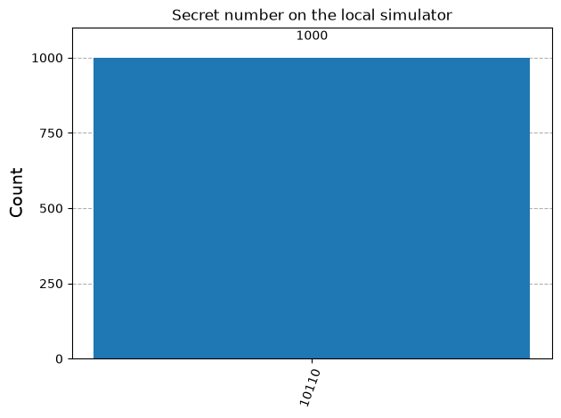
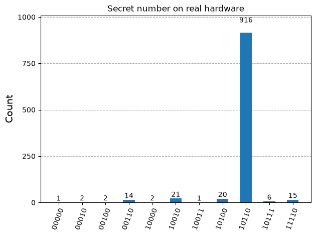

# Lesson 4 — Secret number (Bernstein–Vazirani)

## The idea, before any code

Imagine your friend hides a row of five switches. Some are on and some are off. You can
point to any group of switches, and your friend will tell you whether an **odd** number of
the switches in that group are on. You get one bit back: `1` for odd, `0` for even.

Point to just one switch and the answer tells you whether it is on. Ask that way five
times and you know the whole row. This lesson uses the same question rule in a circuit.
With interference from lesson 3, one call to the question box reveals all five bits.

| Word | Plain meaning |
|---|---|
| **Oracle** | The question box. It knows the hidden switches and answers odd or even for the group you pick. |
| **Phase kickback** | With the helper qubit set up just right, an odd answer turns that part of the wave upside down. |

The one-question result is for this particular rule, where you pick a group and get its
odd-or-even answer. [IBM Quantum Learning](https://quantum.cloud.ibm.com/learning/en/courses/fundamentals-of-quantum-algorithms/quantum-query-algorithms/deutsch-jozsa-algorithm#the-bernstein-vazirani-problem)

## The code

[`secret_number.py`](secret_number.py) hides `10110` in the oracle. The circuit has five
qubits for the question and one helper qubit for the answer.

1. **Get ready.** Flip the helper to `1`, then apply a Hadamard (`H`) to every qubit.
   The question qubits now carry a wave for every possible group of switches.
2. **Ask once.** The oracle uses a controlled flip (`qc.cx()`) for each hidden `1`.
   Each of those gates flips the helper if that switch was picked. The helper's setup
   makes an odd number of flips turn the wave for that group upside down.
3. **Read the secret.** Apply another Hadamard to each question qubit. Just like the
   waves in lesson 3, some parts cancel and others add up. The only result that
   survives is the hidden string. Measure the five question qubits to read it.

Qiskit prints bit 0 on the right, so the code walks through the secret from right to left
when wiring the oracle. That makes the printed answer read `10110` in the usual order.
[Qiskit bit ordering](https://quantum.cloud.ibm.com/docs/en/qiskit/bit-ordering)

```text
     ┌───┐      ░                 ░ ┌───┐┌─┐
q_0: ┤ H ├──────░─────────────────░─┤ H ├┤M├────────────
     ├───┤      ░                 ░ ├───┤└╥┘┌─┐
q_1: ┤ H ├──────░───■─────────────░─┤ H ├─╫─┤M├─────────
     ├───┤      ░   │             ░ ├───┤ ║ └╥┘┌─┐
q_2: ┤ H ├──────░───┼────■────────░─┤ H ├─╫──╫─┤M├──────
     ├───┤      ░   │    │        ░ ├───┤ ║  ║ └╥┘┌─┐
q_3: ┤ H ├──────░───┼────┼────────░─┤ H ├─╫──╫──╫─┤M├───
     ├───┤      ░   │    │        ░ ├───┤ ║  ║  ║ └╥┘┌─┐
q_4: ┤ H ├──────░───┼────┼────■───░─┤ H ├─╫──╫──╫──╫─┤M├
     ├───┤┌───┐ ░ ┌─┴─┐┌─┴─┐┌─┴─┐ ░ └───┘ ║  ║  ║  ║ └╥┘
q_5: ┤ X ├┤ H ├─░─┤ X ├┤ X ├┤ X ├─░───────╫──╫──╫──╫──╫─
     └───┘└───┘ ░ └───┘└───┘└───┘ ░       ║  ║  ║  ║  ║
c: 5/═════════════════════════════════════╩══╩══╩══╩══╩═
                                          0  1  2  3  4
```

The vertical dotted lines are barriers. They keep the two Hadamard stages separate from
the oracle, even on wires where the oracle does nothing. An offline compile against
FakeFez at optimization level 2 kept both Hadamard stages, all three controlled
interactions, and all five measurements.

## What happened when we ran it

Run this from the project folder.

```bash
python lessons/04_secret_number/secret_number.py
```

Here is the local simulator output from 2026-11-26 with seed `2026`.

```text
Results from 1000 shots on the local simulator:
  {'10110': 1000}
Chart saved to simulator_results.png
  Hidden number 10110 appeared in 1000 of 1000 shots (need 100%).
CHECK PASSED
```



Each shot asked the oracle once and recovered the whole number. The script repeated the
experiment 1,000 times to check that every shot gave the same answer.

### On a real quantum computer

IBM's **ibm_fez**, 2026-11-26, 1000 shots (run by Claude after review; about 2 seconds of
quantum time):

```text
10110: 916 (91.6%)   10010: 21   10100: 20   11110: 15   00110: 14   ...
  Hidden number 10110 appeared in 916 of 1000 shots (must beat every other result).
CHECK PASSED
```



- **One question was enough on real hardware too.** More than 9 shots in 10 read the whole
  hidden number from a single call to the oracle.
- **The misses are near-misses.** The next most common answers each differ from `10110` in
  just one bit (`10010`, `10100`, `11110`, `00110`). That's the fingerprint of small
  noise flipping one bit here and there, not of the method failing.
- **Before the run**, a simulator loaded with ibm_marrakesh's published error rates predicted
  about 97%. The real fez run came in a bit lower. Calibration numbers are a guide, not a
  promise.

## How we know it works

The simulator check requires the hidden string in 100% of shots. A completed hardware job
passes if the hidden string occurs more often than every other result. The check prints
`CHECK PASSED` with exit code 0 or `CHECK FAILED` with exit code 1.

## Run it on a real quantum computer

See [HARDWARE.md](../../HARDWARE.md). The first command submits the circuit and prints a job
ID. Once the job finishes, the second command checks its counts and saves a chart.

```bash
python lessons/04_secret_number/secret_number.py --ibm
python lessons/04_secret_number/secret_number.py --job <job-id>
```
