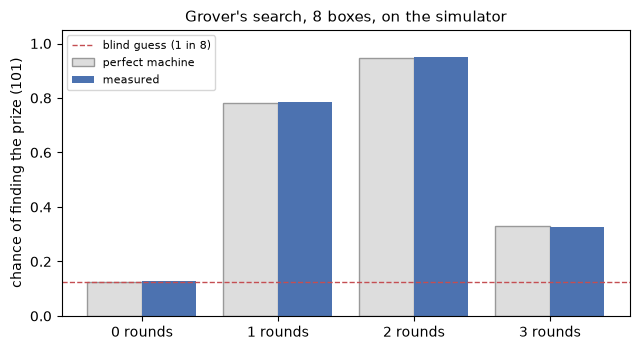
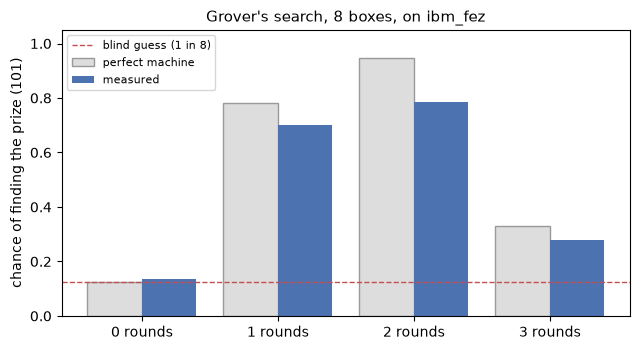

# Lesson 5: Find the prize (Grover's search)

## The idea, before any code

Picture a row of **8 identical closed boxes**. One holds a prize. A helper will tell you
"yes" or "no" if you hand them a box, but you can't see inside. Checking boxes one at a
time takes about 4 tries on average and 7 in the worst case (if the first 7 are empty, the
last one must be it). There's no shortcut: the boxes have no labels and no order to exploit.

A quantum computer can do better by working on **all the boxes at once** and using
interference (lesson 3) to make the prize box "louder" each round:

1. **Open every box a crack.** Put the qubits into an even mix, so all 8 boxes are equally likely.
2. **Mark.** The helper (the *oracle*) flips the wave of the prize box upside down. That
   doesn't change the odds yet, the same way lesson 3's Z gate didn't.
3. **Boost.** Flip every box's wave "around the average". The prize box was pushed below
   average by the mark, so it now jumps far above it, and every other box shrinks a little.
4. **Repeat** mark + boost a few times, then look.

It's like pushing a child on a swing: each push at the right moment adds height. But keep
pushing past the top and you start slowing them down. Grover's search has a best number
of rounds, and **going past it makes the answer worse**. This lesson shows that too.

For 8 boxes the best is 2 rounds. For a huge number of boxes N it's about 0.8 × √N rounds,
versus about N/2 checks one by one. With a million boxes that's roughly 800 rounds versus
500,000 checks.

New words:

| Word | Plain meaning |
|---|---|
| **Oracle** | The helper that recognises the prize. Here it marks the prize box by flipping its wave. |
| **Diffuser** | The "flip around the average" step that turns the mark into extra odds. |
| **Round** | One mark + one boost. Also called a Grover iteration. |

## The code

[`grover.py`](grover.py) builds:

- **4 boxes (2 qubits), prize `11`, 1 round.** With 4 boxes, a single round lands on the
  prize every time on a perfect machine.
- **8 boxes (3 qubits), prize `101`**, with **0, 1, 2 and 3 rounds**, to watch the odds rise
  and then fall.
- **A control**: set the qubits straight to `101` and read them, to measure how often the
  machine just misreads the answer (an idea from ChatGPT's review of lesson 3).

`mark()` is the oracle and `boost()` is the diffuser. Both use a *multi-controlled* gate:
"do something to the last qubit only if all the others are 1". X gates around it shift
which pattern it reacts to, so the oracle reacts to `101` and nothing else.

Barriers separate the stages, as in lesson 3, so the compiler can't merge a whole tiny
circuit into "just set the answer" before it reaches the chip. Before the hardware run we
compiled for an IBM chip and checked that every round really ran: about 20 two-qubit
gates per round with 8 boxes.

## What happened when we ran it

### On the simulator

2026-11-26, 4000 shots each (summary of the script's output):

```
4 boxes, 1 round  -> prize 11 found 100.0%   (guessing: 25%)
8 boxes, prize 101 (guessing: 12.5%):
   0 rounds: 12.9%   (perfect 12.5%)
   1 round:  78.4%   (perfect 78.1%)
   2 rounds: 95.0%   (perfect 94.5%)
   3 rounds: 32.8%   (perfect 33.0%)
CHECK PASSED
```



The measured bars match the perfect ones. Notice 3 rounds: **pushing the swing too long**
dropped the odds from 95% to 33%.

### On a real quantum computer

IBM's **ibm_fez**, 2026-11-26, 4000 shots each (8 seconds of quantum time). All the 8-box
circuits ran on the same three physical qubits.

```
4 boxes, 1 round  -> prize 11 found 96.3%
8 boxes, prize 101:
   0 rounds: 13.5%   (perfect 12.5%)    ~0 two-qubit gates
   1 round:  70.1%   (perfect 78.1%)    20 two-qubit gates
   2 rounds: 78.5%   (perfect 94.5%)    42 two-qubit gates
   3 rounds: 27.8%   (perfect 33.0%)    60 two-qubit gates
control: set straight to 101, read correctly 98.0%
CHECK PASSED
```



What that means:

- **The search works on real hardware.** With 8 boxes, a blind guess finds the prize 12.5%
  of the time. Two rounds found it 78.5% of the time, and the prize was the most common
  answer in every run.
- **The swing effect is real too.** 3 rounds dropped to 27.8%, just as the theory says.
- **This time the noise comes from the gates, not the reading.** The control read `101`
  correctly 98% of the time, so misreading costs only about 2 points. But the gap from
  perfect grows with every round: 1 point at 0 rounds, 8 at 1 round, 16 at 2 rounds.
  Each round adds about 20 two-qubit gates, and each one adds a little error.
  **Lesson 3 couldn't show errors piling up in longer programs. This one does.**
- **Why that matters:** a search through a million boxes would need about 800 rounds, which
  means at least tens of thousands of two-qubit gates. Today's chips can't run that many
  before the noise drowns the answer. That's why researchers work on reducing and
  correcting errors. Lesson 6 looks at the noise up close.

## How we know it works

On the simulator, the script prints `CHECK PASSED` only if:

- 4 boxes finds the prize in 100% of shots,
- 8 boxes with 2 rounds finds it at least 90% of the time,
- every round is within 3 percentage points of the perfect number.

On hardware the bar is "the search clearly works": the prize is the most common answer
for 4 boxes and for 8 boxes at 2 rounds, and 2 rounds beats both 0 rounds and 3 rounds.

## Run it on a real quantum computer yourself

See [HARDWARE.md](../../HARDWARE.md). Once your account is saved:

```bash
python lessons/05_grover_search/grover.py --ibm
python lessons/05_grover_search/grover.py --job <job-id>
```
