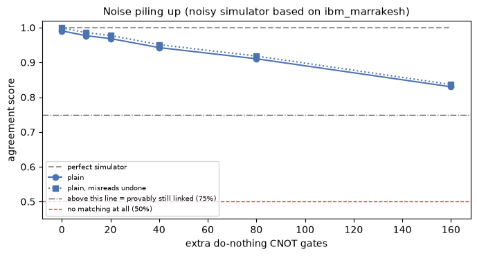
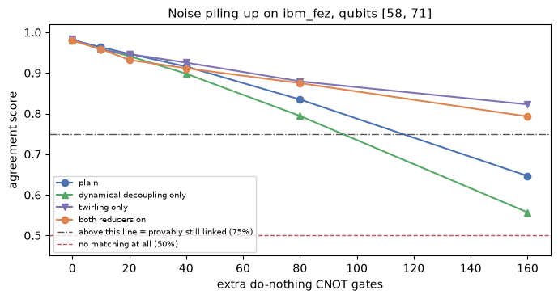
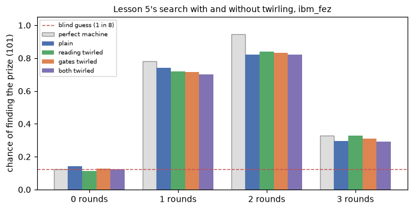

# Lesson 6: Real machines are noisy (and what helps)

## The idea, before any code

Make a **photocopy of a photocopy of a photocopy**. Each copy is almost perfect, but the
tiny smudges add up, and by the 50th copy the page is grey mush.

Every gate on a real quantum computer is like one copy: almost perfect, with a tiny error.
Lessons 1–5 used short programs, so the errors stayed small. Lesson 5 hinted at the
problem: each extra round of the search made the gap from perfect wider. This lesson
looks at that head on, then tries three ways to fight back.

**The experiment:** make lesson 1's magic coins (two linked qubits that always agree), then
add pairs of CNOT gates that **cancel each other out**. In theory those pairs do nothing at
all. A perfect machine would still give 100% agreement after 160 of them. A real machine
blurs things a little with every gate.

We measure an **agreement score**: the average of how often the coins match straight and
sideways (lesson 1).

- **100%** is a perfect link.
- **Above 75%**, the score proves the coins are still quantum-linked. No pair of pre-agreed
  ordinary coins can match that often both ways.
- **Below 75%**, pre-agreed coins could fake it, so the score no longer proves a link.
- **50%** means no matching at all, which is what two unrelated coin flips give.

**Three ways to fight noise:**

1. **Undo misreads.** Set the qubits straight to `00`, `01`, `10`, `11` and read them, to
   learn exactly how often the machine misreads each answer. Then work backwards: find the
   true odds that, after that much misreading, give what we saw. (It's like knowing your
   bathroom scale reads 2 pounds heavy and subtracting it.)
2. **Dynamical decoupling.** While a qubit sits idle, it slowly drifts. Decoupling flips it
   over halfway through the wait, so the drift in the second half undoes the drift in the
   first. It's like telling runners to turn around halfway: whatever their speed, they all
   arrive back at the start together.
3. **Twirling.** Some errors are *systematic*: the same small over-rotation every time, so
   they line up and reinforce each other, like a car that pulls slightly left. Twirling wraps
   each two-qubit gate (and, optionally, the final reading) in random flips that don't
   change the answer but scramble the error's direction from run to run. Systematic errors
   become random ones, which still add up, but only gate by gate instead of reinforcing
   each other.

New words:

| Word | Plain meaning |
|---|---|
| **Noise** | All the small errors a real machine adds: in gates, while idle, and when reading. |
| **Error mitigation** | Tricks that reduce the damage from noise without fixing the hardware. |
| **Systematic (coherent) error** | An error that's the same every time, so errors line up and the damage grows faster and faster. |

## The code

[`noise.py`](noise.py):

- `build_bell(pairs, sideways)`: lesson 1's magic coins plus `pairs` cancelling CNOT pairs, with
  barriers so the compiler can't delete them (lesson 3). Depths: 0, 10, 20, 40, 80 and 160
  extra CNOTs. We checked that the compiled circuits really contain every one.
- `build_ready(bits)`: the four "set it and read it" controls.
- `correct_readout()`: works backwards from the misread rates (a small 4×4 equation solve).
- On real hardware, the same 16 circuits are sent as **four jobs** on the same two qubits:
  plain, decoupling only, twirling only, and both. These are IBM's built-in options
  (`dynamical_decoupling.enable`, `twirling.enable_gates`, `twirling.enable_measure`).
- `loss_per_cnot()` fits a smooth fade and reports what share of the remaining agreement
  (above coin-flip level) each extra CNOT costs.

[`grover_twirl.py`](grover_twirl.py) reruns lesson 5's 8-box search with and without twirling.

## What happened when we ran it

### On the simulators

2026-11-26, 4000 shots each:

```
perfect simulator agreement: 100% at every depth (the pairs really do nothing)
noisy simulator (copies ibm_marrakesh's published error rates):
   extra CNOTs:          0     10     20     40     80    160
   agreement:        99.1%  97.7%  96.9%  94.3%  91.1%  83.0%
   misreads undone:  99.9%  98.6%  97.8%  95.1%  91.8%  83.7%
   agreement lost per extra CNOT: 0.24%
CHECK PASSED
```



The "noisy simulator" is an ordinary computer pretending to be ibm_marrakesh, using the
error rates IBM publishes for it. Those rates describe random-style errors only, so by
construction it predicts a slow, steady fade with nothing lining up.

### On a real quantum computer

IBM's **ibm_fez**, qubits 58 and 71, 2026-11-26, 4000 shots each, four jobs in one go
(about 80 seconds of quantum time). Agreement score:

| Extra CNOTs | 0 | 10 | 20 | 40 | 80 | 160 | Lost per CNOT* |
|---|---|---|---|---|---|---|---|
| Plain | 98.1% | 96.3% | 94.7% | 91.6% | 83.5% | **64.6%** | ~0.74% |
| Decoupling only | 98.0% | 95.9% | 94.2% | 89.8% | 79.4% | 55.7% | ~1.33% |
| **Twirling only** | 98.3% | 95.7% | 94.6% | 92.5% | 87.9% | **82.2%** | 0.24% |
| Both | 98.0% | 95.9% | 93.2% | 91.1% | 87.5% | 79.3% | 0.30% |

\* After undoing misreads. For plain and decoupling the fade isn't steady (it speeds up), so
their figure is only a rough average.



What that means:

- **Noise really does pile up.** With no extra gates the coins agreed 98% of the time. After
  160 do-nothing gates, plain, only 64.6%: below the 75% line, so that run can no longer prove
  the coins are linked at all.
- **Twirling kept the link provable.** With twirling, 160 gates still left 82.2%, comfortably
  above 75%. Counting points above coin-flip level, twirling kept 32 of the original 50 at 160
  gates, versus 15 plain: about twice as much agreement left. The gap is small early on and
  grows with more gates.
- **Undoing misreads fixes the start, not the fade.** It raised the zero-gate score from 98.1%
  to 99.1%, but did almost nothing at 160 gates. Misreads happen once, at the end; gate errors
  happen at every gate.
- **Decoupling made no clear difference.** In this circuit the qubits are never idle for longer
  than one very short gate, too short to fit a decoupling pulse pair, so it most likely added
  nothing. When we compiled the same circuits ourselves for a copy of this chip, Qiskit's
  decoupling step inserted no pulses at all. Its gap from plain is about the size of the
  run-to-run drift we saw (below). Decoupling is the right tool for circuits where qubits wait around.
- **Why twirling helped (our best explanation).** Look at the plain line in the chart: it doesn't
  fade steadily, it *bends downward faster and faster*. That's the signature of systematic
  errors lining up and reinforcing each other. The twirled line fades steadily instead.
  - Its rate, 0.24% per CNOT, is just what IBM's published numbers predict. IBM lists 0.17% error
    for one two-qubit gate on these qubits, but measures it a different way. For random-style
    noise, 0.17% should make this score fade by about 0.23% per CNOT, plus a little for the
    single-qubit gates inside each CNOT. (Our noisy simulator copies a different chip, but its
    qubit pair has the same 0.17% figure and gives the same 0.24%.)
  - IBM measures those rates with randomized tests, which in effect twirl the errors. So the
    published rates describe a twirled circuit. Without twirling, the same errors can line up
    and add up faster.
  - This test can't prove that explanation on its own, but everything fits.
- **Runs drift.** An earlier plain run on the same qubits, about 15 minutes before, ended at 59.0%
  at 160 gates instead of 64.6%. The twirled results were steadier: 76.0% with both reducers that
  time, 79.3% this time. Real hardware changes from hour to hour, which is one more reason to
  compare options **in the same session, on the same qubits**, as we did.

### Does twirling rescue lesson 5's search?

[`grover_twirl.py`](grover_twirl.py), run twice on 2026-11-26, 4000 shots per job. Chance of
finding the prize among 8 boxes (perfect machine: 12.5%, 78.1%, 94.5%, 33.0% for 0–3 rounds).

**Run 1: IBM's ibm_kingston, qubits 147–149** (two jobs; gate and reading twirling together):

| Rounds | 0 | 1 | 2 | 3 | Readout control |
|---|---|---|---|---|---|
| Plain | 11.7% | 52.8% | 57.1% | 21.0% | 81.3% |
| Twirled | 13.7% | 60.5% | 65.3% | 25.8% | 88.2% |

Twirling added about 8 points, but part of that is the reading alone. These qubits misread a
lot (the control was only 81% correct), and superconducting qubits mostly misread 1 as 0.
Measurement twirling averages that habit out across 0s and 1s, which happens to help the prize
`101` (two 1s). Adjusting for the readout control, gate twirling itself added only about 4 points.

**Run 2: IBM's ibm_fez, qubits 142–144** (four jobs, to split the two kinds of twirling):

| Rounds | 0 | 1 | 2 | 3 | Readout control |
|---|---|---|---|---|---|
| Plain | 14.1% | 74.3% | 82.2% | 29.7% | 98.1% |
| Reading twirled | 11.4% | 72.0% | 83.9% | 32.8% | 98.5% |
| Gates twirled | 12.8% | 71.7% | 83.1% | 30.9% | 98.4% |
| Both twirled | 12.4% | 70.2% | 82.0% | 29.2% | 98.7% |



**On good qubits, twirling made no difference.** All four versions scored 82–84% at 2 rounds,
within the ±1.2 points that 4000 shots wobble by from chance alone.

What we take from the two runs:

- **Twirling's gain on the search came mostly from fixing bad readout** on kingston's qubits.
  On fez's qubits, which read correctly 98% of the time, there was nothing for it to fix.
- **Gate twirling helps most when errors can line up.** The cancelling-CNOT test is the worst
  case: 160 copies of the same gate, so a systematic error reinforces itself 160 times. The
  search uses about 40 two-qubit gates mixed with many different single-qubit gates, so
  errors line up much less. That's our best explanation, not something this test proves.
- **Which machine and which qubits you get still matters more than any single trick:** 57%
  plain on kingston versus 82% plain on fez, for the same circuit on the same night.

## The big picture

Mitigation tricks like these stretch what today's machines can do, but they don't remove
noise. They only manage it, and the stronger methods need far more runs as programs get
longer, so mitigation alone can't scale to big programs. To run long programs (lesson 5's
million-box search, or breaking real encryption), the field is building **error-corrected**
qubits: many noisy physical qubits working together as one reliable "logical" qubit. That's
what most of the field's big upcoming milestones are aimed at.

## How we know it works

On the simulators, `noise.py` prints `CHECK PASSED` only if:

- the perfect simulator scores 100% at every depth (the extra pairs really do nothing),
- the noisy simulator's score drops by more than 5 points from 0 to 160 extra CNOTs,
- undoing misreads raises the starting score.

On hardware: the plain score starts at 85% or higher, drops by more than 5 points by 160 extra
CNOTs, and undoing misreads raises the starting score. The comparison between reducers is
reported, not graded, because it's the thing being measured.

`grover_twirl.py` passes if, with both kinds of twirling on, 2 rounds still beats 0 and 3 rounds.

## Run it on a real quantum computer yourself

See [HARDWARE.md](../../HARDWARE.md). Once your account is saved:

```bash
python lessons/06_noise/noise.py --ibm          # four jobs, about 80 seconds of quantum time
python lessons/06_noise/noise.py --job
python lessons/06_noise/grover_twirl.py --ibm   # four jobs, about 30 seconds
python lessons/06_noise/grover_twirl.py --job
```

The job IDs are saved in small `.last_job.json` files next to the scripts (left out of git),
so `--job` needs no arguments.
