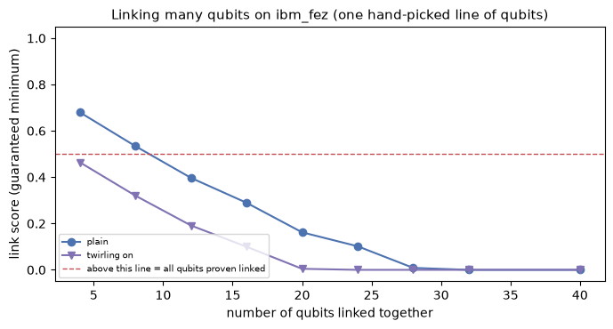
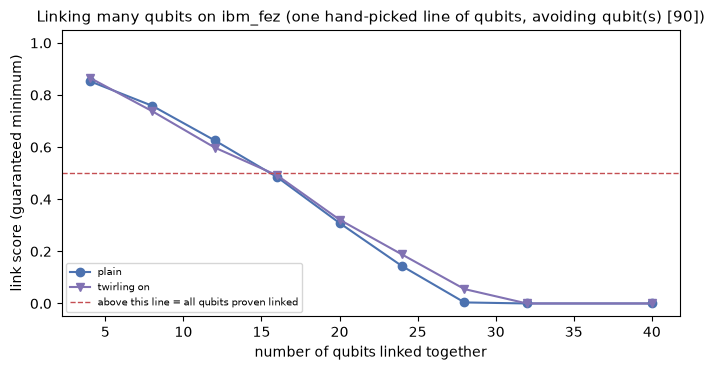

# Lesson 7: How many qubits can we link?

## The idea, before any code

Lesson 1 linked **two** magic coins. Now try a whole **row** of them: 4, 8, 16, 20 and more,
all linked so they either all land 0 or all land 1. Physicists call this a **GHZ state**
(after Greenberger, Horne and Zeilinger), and "how big a GHZ state can you make?" is a
standard way to compare quantum computers.

Think of a row of dominoes standing in a line. Tip the middle one and the fall spreads both
ways. On a perfect machine every domino falls. On a real one, every push has a tiny chance
of going wrong, and a longer row gives more chances. Somewhere the link gets too weak to
prove. This lesson finds where.

**Proving a group is linked is the hard part.** "All agree" alone isn't enough. As in
lesson 1, pre-agreed ordinary coins can fake that, so we also look sideways. With many
qubits we have to be careful how we combine the two looks:

- **Quick test (`ghz.py`):** straight + sideways, combined with a standard formula called an
  *entanglement witness*. It gives a **guaranteed minimum**. Above 50% proves the whole
  group is linked as one, but it's cautious, so a real link can fall just short.
- **Thorough test (`parity_sweep.py`):** turn every qubit by the same small angle, look
  sideways, and repeat at many angles. A genuinely linked group of 16 makes the sideways count
  wiggle **exactly 16 times** per full turn. Nothing smaller than the whole group can wiggle
  that fast, so the size of that fast wiggle measures the whole-group link directly.

New words:

| Word | Plain meaning |
|---|---|
| **GHZ state** | A group of qubits linked so they all agree: all 0s or all 1s. |
| **Link quality (fidelity)** | How close the real state is to the perfect GHZ state, from 0% to 100%. Above 50% proves the whole group is linked. |
| **Entanglement witness** | A test that can prove a link exists, but can't by itself prove one doesn't. |

## The code

[`ghz.py`](ghz.py):

- `build_ghz(n, sideways)` starts at the middle qubit and spreads the link outward both ways
  at once, so a group of 16 takes about 8 steps instead of 16.
- `link_score()` is the quick test: **all-agree share + ½ × sideways (even − odd) − ½**.
  This is the *Tóth–Gühne witness*, and it's always at or below the true link quality.
- **A mistake we caught:** our first draft used the plain average of the two numbers. That
  looks reasonable, and for two qubits it works, but for bigger groups it is **not** a safe
  minimum: in the sideways test, other combinations of qubits can leak in and flatter the
  score. That draft would have claimed 20 linked qubits. With the correct formula, the same
  data proves 12.
- `best_chain()` hand-picks a line of connected qubits with the lowest published error
  rates. `--avoid` leaves out qubits we've measured to be bad.
- Every score comes with its **chance wobble** (one standard error from the shot count), and
  we only say "proven" when the score is above 50% by more than two wobbles.

[`weak_link.py`](weak_link.py) tests a hand-picked line piece by piece: every neighbouring
pair, and every qubit's reading.

[`parity_sweep.py`](parity_sweep.py) is the thorough test. We checked it on a simulated
noisy 8-qubit state whose true link quality is known exactly (83.4%). It measured 83.0%.

## What happened when we ran it

All runs on 2026-11-26, 4000 shots per circuit unless noted. Scores are the quick-test
minimum; "proven" means above 50% by more than 2 chance wobbles.

### 1. Let the compiler pick qubits for each size (ibm_fez)

| Qubits | 2 | 4 | 8 | 12 | 16 | 20 | 24 | 28 |
|---|---|---|---|---|---|---|---|---|
| Plain | 96.6% | 90.1% | 78.6% | **65.1%** | 49.4% | –3% | 11% | –20% |
| Twirling on | 95.6% | 90.1% | 75.7% | **64.9%** | 47.6% | –8% | 2% | –19% |


**12 qubits proven. 16 just short.** Below zero just means "this test proves nothing". The
collapse at 20 (and 24 doing better than 20) suggested a bad qubit got pulled in somewhere.

### 2. One hand-picked line for every size (ibm_fez)

To make sizes comparable, we picked one 40-qubit line by IBM's published error rates and took
every group from its middle, so each bigger group contains the smaller ones. It went
**worse**: even 4 qubits scored only 68%, and nothing past 8 was proven.



### 3. Find the weak link (ibm_fez, 1000 shots per circuit)

[`weak_link.py`](weak_link.py) tested each of the 39 neighbouring pairs and each of the 40 qubits:

```
37 of 39 pairs: 94-99% (fine)
pairs 91-90 and 90-89: 77%  <-- weak
qubit 90 reading test: read 0 correctly only 57.9% of the time (IBM's published readout error: 0.4%)
```

**Qubit 90 was the culprit.** It sat in the middle of the line, so every group contained it.
Its published calibration said it was one of the best readers on the chip. In reality it was
the worst. Calibration data is a snapshot, and qubits drift.

### 4. Same method, avoiding qubit 90 (ibm_fez)

| Qubits | 4 | 8 | 12 | 16 | 20 | 24+ |
|---|---|---|---|---|---|---|
| Plain | 85.3% | 75.9% | **62.6%** | 48.5% | 30.9% | ≤ 14% |
| Twirling on | 86.6% | 73.8% | **59.9%** | 49.2% | 32.1% | ≤ 19% |



Back to the run-1 level: **12 proven, 16 just short**, now with nested groups.

A repeat on **ibm_kingston** (twirling on, sizes 16–24) put 16 qubits at 51.6% ± 1.0%: above
50%, but not by two wobbles. Three runs on two machines all put 16 qubits right on the edge of
what the quick test can prove.


### 5. The thorough test: phase sweep (ibm_marrakesh, twirling on, 2000 shots per circuit)


```
16 qubits: all agree 65.4%, 16-times wiggle size 0.45  ->  link quality 55.2% ± 0.6%  PROVEN
20 qubits: all agree 52.3%, 20-times wiggle size 0.32  ->  link quality 42.0% ± 0.6%  not proven
```

The dots follow the red 16-times wiggle closely. **All 16 qubits were linked as one group**,
about 8 wobbles above the line. 20 qubits fell short.

## What that means

- **Final answer for tonight: 16 qubits proven linked as one group** (ibm_marrakesh, thorough
  test), and 12 proven by the cautious quick test in every fez run.
- **The careful maths mattered as much as the hardware.** The tempting simple formula would
  have claimed 20. The honest one said 12, and the better measurement found 16. On a portfolio
  piece that's the difference between a claim and a result.
- **Published calibration can be badly wrong for a single qubit** (qubit 90: 0.4% listed,
  about 42% real misreads of 0). Testing your own qubits before a big run pays off.
- **Bigger groups are harder in a predictable way.** Each extra qubit adds one more link that
  can go wrong, so the score drops roughly steadily with size until it can no longer prove
  anything.
- **For scale:** research groups have reported verified GHZ states of 100 and more qubits
  on the best current hardware, using more careful calibration, better qubit choice and
  error-detection tricks. 16 on a free account with a few minutes of machine time is a
  respectable first result.

## How we know it works

- `ghz.py` on the simulators: the perfect simulator must score 100% at every size up to 28
  (the circuit is right), and the noisy copy of ibm_marrakesh must score lower at 12 qubits
  than at 2 (noise grows with size). On hardware: 2 qubits proven, and the score falls as the
  group grows.
- `parity_sweep.py` on the perfect simulator must give 100% (± 3 points) for 16 and 20 qubits.
  It was also checked against the exact answer for a noisy 8-qubit state (83.0% vs 83.4%).

## Run it on a real quantum computer yourself

See [HARDWARE.md](../../HARDWARE.md). Approximate quantum time in brackets:

```bash
python lessons/07_linking_many/ghz.py --ibm                      # run 1 (40 s)
python lessons/07_linking_many/ghz.py --ibm --chain              # run 2 (40 s)
python lessons/07_linking_many/weak_link.py --ibm                # run 3 (25 s)
python lessons/07_linking_many/ghz.py --ibm --chain --avoid 90   # run 4 (40 s)
python lessons/07_linking_many/parity_sweep.py --ibm             # run 5 (50 s)
```

Then the same commands with `--job` instead of `--ibm` (and without the other flags) to check
the results. Bad qubits change from day to day, so run `weak_link.py` first and pass whatever it
flags to `--avoid`. Qubit 90 was only bad on ibm_fez that night.
