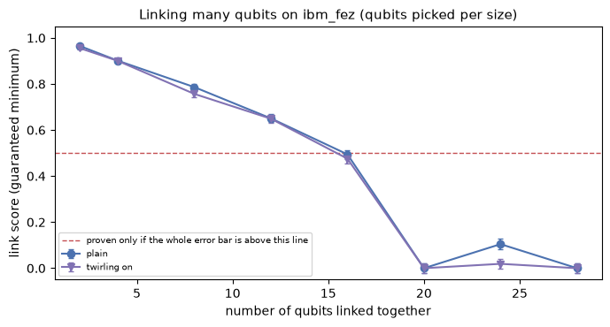
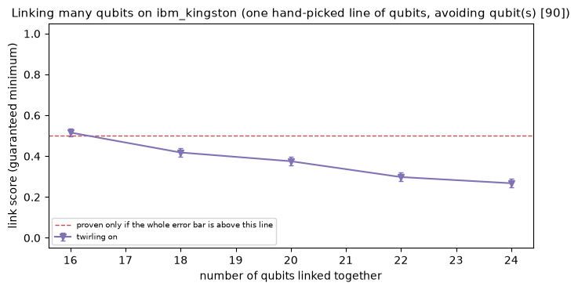
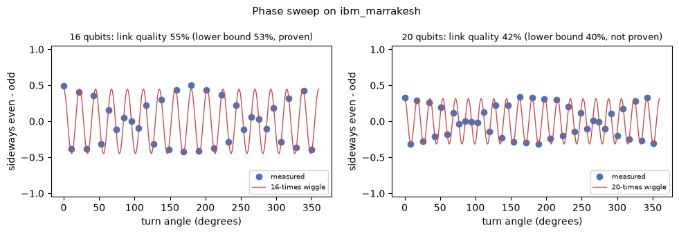
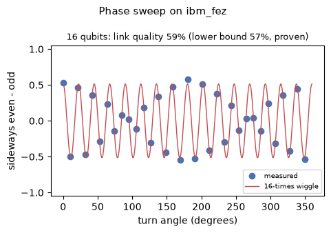

# Lesson 7: How many qubits can we link?

## The idea, before any code

Lesson 1 linked **two** magic coins. Now try a whole **row** of them: 4, 8, 16, 20 and more,
all linked so they either all land 0 or all land 1. Physicists call this a **GHZ state**
(after Greenberger, Horne and Zeilinger), and "how big a GHZ state can you make?" is a
standard way to compare quantum computers.

Think of a row of dominoes standing in a line. Tip the middle one and the fall spreads both
ways. On a perfect machine every domino falls. On a real one, every push has a tiny chance
of going wrong, and a longer row gives more chances. Somewhere the link gets too weak to
prove. This lesson finds where.

**Proving a group is linked is the hard part.** "All agree" alone isn't enough. As in
lesson 1, pre-agreed ordinary coins can fake that, so we also look sideways. With many
qubits we have to be careful how we combine the two looks:

- **Quick test (`ghz.py`):** straight + sideways, combined with a standard formula called an
  *entanglement witness*. It gives a **guaranteed minimum**. Above 50% by more than two
  chance wobbles proves the whole group is linked as one, but it's cautious, so a real link
  can fall just short.
- **Thorough test (`parity_sweep.py`):** turn every qubit by the same small angle, look
  sideways, and repeat at many angles. A linked group of 16 makes the sideways count wiggle
  **exactly 16 times** per full turn. Only the whole group's all-0s/all-1s link makes that
  fast a wiggle. Groups that aren't fully linked can still make a faint one, so we combine
  its size with the all-agree share. Proven when its cautious lower bound is above 50%.

New words:

| Word | Plain meaning |
|---|---|
| **GHZ state** | A group of qubits linked so they all agree: all 0s or all 1s. |
| **Link quality (fidelity)** | How close the real state is to a perfect GHZ state, from 0% to 100%. Above 50% proves the whole group is linked. (The phase sweep measures closeness to the nearest GHZ state, allowing any phase twist between all-0s and all-1s; the 50% line is the same for all of them.) |
| **Entanglement witness** | A test that can prove a link exists, but can't by itself prove one doesn't. |

## The code

[`ghz.py`](ghz.py):

- `build_ghz(n, sideways)` starts at the middle qubit and spreads the link outward both ways
  at once, so a group of 16 takes about 8 steps instead of 16.
- `link_score()` is the quick test: **all-agree share + ½ × sideways (even − odd) − ½**.
  This is the *Tóth–Gühne witness*, and it's always at or below the true link quality.
- **A mistake we caught:** our first draft averaged the all-agree share with the sideways
  even-minus-odd number. That's the usual fidelity formula *if* the sideways number only
  measured the whole-group link, but it doesn't: other combinations of qubits leak in and can
  flatter the score, even for two qubits. On run 4 and the kingston repeat (below) that draft
  would have claimed 20 linked qubits. With the correct formula, the same data proves 12 and
  none respectively. (Lesson 6's 75% rule, the average of agree-straight and agree-sideways,
  was already safe: it turns out to be exactly this witness.)
- `best_chain()` hand-picks a line of connected qubits with the lowest published error
  rates. `--avoid` leaves out qubits we've measured to be bad.
- Every score comes with its **chance wobble** (one standard error from the shot count), and
  we only say "proven" when the score is above 50% by more than two wobbles. The wobble covers
  shot noise only, not the machine itself changing between runs.

[`weak_link.py`](weak_link.py) tests a hand-picked line piece by piece: every neighbouring
pair, and every qubit's reading.

[`parity_sweep.py`](parity_sweep.py) is the thorough test. Its simulator check includes a
noisy 8-qubit state whose true link quality can be computed exactly (83.4%). The sweep
measured 83.1%, with a cautious lower bound of 82.6%.

## What happened when we ran it

All runs on 2026-11-26, 4000 shots per circuit unless noted. Scores are the quick-test
minimum; "proven" means above 50% by more than 2 chance wobbles (run 5 uses its own cautious
lower bound; see below).

### 1. Let the compiler pick qubits for each size (ibm_fez)

| Qubits | 2 | 4 | 8 | 12 | 16 | 20 | 24 | 28 |
|---|---|---|---|---|---|---|---|---|
| Plain | 96.6% | 90.1% | 78.6% | **65.1%** | 49.4% | –3% | 11% | –20% |
| Twirling on | 95.6% | 90.1% | 75.7% | **64.9%** | 47.6% | –8% | 2% | –19% |



**12 qubits proven.** Below zero just means "this test proves nothing".

**Caught in ChatGPT's review:** in this run the compiler placed each straight and sideways
half separately. For 16, 20 and 28 qubits, the two halves landed on **different physical
qubits**, so those three scores combine measurements of two different groups and mean nothing.
We checked the saved jobs: at 12 qubits both halves read the same qubits (and avoided qubit 90,
the bad qubit we find in run 3), so the 12-qubit proof stands. Both 20-qubit halves also used
qubit 90, while 24 avoided it. That probably explains why 24 beat 20. Either way, 16, 20 and
28 prove nothing.
The script now pins each sideways half to its straight half's qubits, and when it reads results
back it checks the job and marks any mismatched size **NOT VALID**. The chart shows the scores
as measured; treat 16, 20 and 28 as void.

### 2. One hand-picked line for every size (ibm_fez)

To make sizes comparable, we picked one 40-qubit line by IBM's published error rates and took
every group from its middle, so each bigger group contains the smaller ones. It went
**worse**: even 4 qubits scored only 68%, and nothing past 8 was proven.


### 3. Find the weak link (ibm_fez, 1000 shots per circuit)

[`weak_link.py`](weak_link.py) tested each of the 39 neighbouring pairs and each of the 40 qubits:

```
37 of 39 pairs: 94-99% (fine)
pairs 91-90 and 90-89: 77%  <-- weak
qubit 90 reading test: read 0 correctly only 57.9% of the time (IBM's published readout error: 0.4%)
```

**Qubit 90 was the culprit.** It sat in the middle of the line, so every group contained it.
It came out 1 about 42% of the time when it should have been 0, far worse than the 0.4%
readout error listed for it. Whether it was misreading or not resetting properly, the
published numbers didn't show it. Calibration is a snapshot, and individual qubits can go
bad between calibrations.

### 4. Same method, avoiding qubit 90 (ibm_fez)

| Qubits | 4 | 8 | 12 | 16 | 20 | 24+ |
|---|---|---|---|---|---|---|
| Plain | 85.3% | 75.9% | **62.6%** | 48.5% | 30.9% | ≤ 14% |
| Twirling on | 86.6% | 73.8% | **59.9%** | 49.2% | 32.1% | ≤ 19% |


Back to the run-1 level at 12 qubits: **12 proven, and 16 just short**, now with nested groups.

A repeat on **ibm_kingston** (twirling on, sizes 16–24) put 16 qubits at 51.6% ± 1.0%: above
50%, but not by two wobbles, so **nothing was proven** and that run fails its check. Run 4 and
this repeat both put 16 qubits right on the edge of what the quick test can prove (run 1's
16-qubit score is void).



### 5. The thorough test: phase sweep (ibm_marrakesh, twirling on, 2000 shots per circuit)



```
16 qubits: all agree 65.4%, 16-times wiggle size 0.45  ->  link quality 55.2%  (cautious lower bound 53.4%)  PROVEN
20 qubits: all agree 52.3%, 20-times wiggle size 0.32  ->  link quality 42.0%  (cautious lower bound 40.2%)  not proven
all circuits for each size read the same physical qubits: yes
```

The dots follow the red 16-times wiggle closely. **All 16 qubits were linked as one group.**
20 qubits fell short.

**How sure is "proven"? (fixed after ChatGPT's review)** The wiggle's size is *fitted*: we
pick whichever phase matches best, so random noise always produces some wiggle. Our first
rule ("estimate minus 2 wobbles above 50%") didn't allow for that. In 20,000 simulated runs
of an *unlinked* state sitting exactly on the 50% line, it said "proven" about 13% of the time.
The script now uses a cautious lower bound: 2 wobbles off the all-agree share, and 2 generous
wobbles off the wiggle size. In the hardest case we simulated (an unlinked state exactly on the 50% line), that falsely
proves about 2% of the time, and under 1% for the other unlinked states we tried, and it still proves our measured 16-qubit point every time.
On the real data the bound is 53.4%, so **the 16-qubit result survives the stricter test.**

The sweep's first angle (0°) is exactly the quick test's sideways look, so the same data also
gives the cautious quick score: **39.9% ± 1.4% for 16 qubits**, nowhere near proving it. On
identical data, the quick test missed a link the thorough test proved. That suggests fez's
16-qubit group in run 4 (just under 50% on the quick test) may well have been linked too, just
not provably that way.

### 6. Can we reproduce it? Same qubits, plus a control (ibm_marrakesh, 2026-11-27)

An idea from ChatGPT's review: repeat run 5 for 16 qubits on the **same machine, the same
16 physical qubits and the same twirling settings**, and add a **control** to the same job.
Every circuit also runs a second time with a Z gate on one qubit straight after the linking.
That flips the sign of the whole-group link, so pooling the shots with and without the Z
cancels the link exactly: the pooled results come from a plain mix of "all 0s" and "all 1s"
with no quantum link. The control's 16-times wiggle should vanish, and it must not come out
proven. ([`parity_repeat.py`](parity_repeat.py); 70 circuits × 2000 shots, 45 seconds of
quantum time. The repeat reuses the no-Z half of the control's circuits.)

```
all 70 circuits read the same physical qubits: yes
repeat:  all agree 57.9%, wiggle size 0.396  ->  link quality 48.7%, cautious lower bound 46.9%  not proven
control: all agree 58.8%, wiggle size 0.007  ->  link quality 29.8%, cautious lower bound 28.5%  not proven
```

- **The control worked.** With the link cancelled, the 16-times wiggle dropped from about 0.4
  to 0.007: essentially zero, as it should be.
- **The repeat did not reproduce run 5.** Same qubits, same settings, but "all agree" fell from
  65.4% to 57.9% and the link quality from 55.2% to 48.7%, just short of the line.
- **The repeat followed a recalibration.** It ran 10.4 hours after run 5, and IBM recalibrated
  ibm_marrakesh 50 minutes before it. That timing makes drift a likely explanation (lessons 3,
  6 and 7 all saw qubits change between runs), but this experiment didn't establish the cause.
  All we know is that the same qubits and settings gave a weaker result the next morning.

### 7. A fresh try on today's best qubits (ibm_fez, 2026-11-27)

So we ran the thorough test once more on fresh qubits (`parity_sweep.py --ibm --sizes 16`;
35 circuits × 2000 shots, 23 seconds). The script picked the machine automatically (the least
busy one, which was ibm_fez) and chose the line of 16 qubits from that morning's published
calibration data with `best_chain()`, **before the run, without looking at any results**:

```
all 35 circuits read the same physical qubits: yes
16 qubits: all agree 66.1%, wiggle size 0.52  ->  link quality 58.8%  (cautious lower bound 57.1%)  PROVEN
(same data, cautious quick score: 42.7% ± 1.4%)
```



**16 qubits proven again**, on a different machine and a different set of qubits, and by a
wider margin than the first time.

### Check our numbers yourself

[`data/`](data/) holds what each phase-sweep run measured on real hardware:
- the machine and physical qubits
- the straight-measurement totals
- the even/odd counts after every turn angle
- whether every circuit read the same qubits

No job IDs or account details. [`recompute.py`](recompute.py) rebuilds every bound above from
those files, no IBM account needed:

```bash
python lessons/07_linking_many/recompute.py
```

## What that means

- **Final answer: 16 qubits proven linked as one group, on two different machines.** The
  thorough test proved it on ibm_marrakesh (cautious lower bound 53.4%) and again the next
  day on fresh qubits on ibm_fez (57.1%). A repeat on the original marrakesh qubits after an
  overnight recalibration fell just short (46.9%), and we report that too. The cautious quick
  test proved 12 in both fez runs that left out the bad qubit (runs 1 and 4).
- **The careful maths mattered as much as the hardware.** The tempting simple formula would
  have claimed 20 on two of the runs. The honest cautious test proved 12, and the better
  measurement, on ibm_marrakesh, proved 16. On a portfolio piece, that's the difference
  between a claim and a result.
- **Published calibration can be badly wrong for a single qubit.** Qubit 90: 0.4% readout
  error listed, about 42% wrong in our test. Testing your own qubits before a big run pays off.
- **Bigger groups get harder faster.** The score falls more steeply the bigger the group gets:
  every extra qubit is one more link that can fail, and one more place for the whole group's
  balance to be spoiled while it waits.
- **For scale:** in late 2025, IBM researchers reported a 120-qubit GHZ state (link quality
  about 56%, just over the line), using error detection that threw away roughly three runs in
  four, plus careful qubit choice (Javadi-Abhari et al., "Big cats", arXiv:2510.09520).
  16 qubits on a free account, with no error detection and a few minutes of machine time, is a
  respectable first result.

## How we know it works

`ghz.py` on the simulators, 2026-11-27 (4000 shots each, summary of the script's output):

```
perfect simulator, 2 to 28 qubits: link score 100.0% at every size
noisy simulator (copies ibm_marrakesh's published error rates):
   qubits:       2      4      8     12
   link score:  97.9%  95.2%  89.0%  83.5%
CHECK PASSED
```

It passes only if the perfect simulator scores 100% at every size up to 28 (the circuit is
right) and the noisy copy scores lower at 12 qubits than at 2 (noise grows with size).

`parity_sweep.py` on the simulators, 2026-11-27 (2000 shots per circuit; 20,000 for the noisy test):

```
16 qubits: link quality 99.9% (cautious lower bound 99.3%)
20 qubits: link quality 100.0% (cautious lower bound 99.5%)
noisy 8-qubit test: sweep estimate 83.1% (lower bound 82.6%), exact answer 83.4%
CHECK PASSED
```

It passes only if the perfect simulator gives 100% (± 3 points) for 16 and 20 qubits, and on a
noisy 8-qubit state, where the exact answer can be computed directly, the estimate lands within
1 point of it with the lower bound below it.

On hardware, `ghz.py --job` passes only if the smallest group tried is proven linked by the same
rule used everywhere else (above 50% by more than 2 wobbles, on the same physical qubits), and
the largest group scores lower than the smallest. The chart draws each score with a ±2-wobble error bar; a
size counts as proven only if its whole bar is above the 50% line.

## Run it on a real quantum computer yourself

See [HARDWARE.md](../../HARDWARE.md). Each `--ibm` run saves its job IDs in a small
`.last_*.json` file next to the scripts (left out of git), and the next `--ibm` run of the same
script overwrites it. So **check each run with `--job` before starting the next one.**
Approximate quantum time in brackets:

```bash
python lessons/07_linking_many/ghz.py --ibm                      # run 1 (40 s), then: ghz.py --job
python lessons/07_linking_many/ghz.py --ibm --chain              # run 2 (40 s), then: ghz.py --job
python lessons/07_linking_many/weak_link.py --ibm                # run 3 (25 s), tests run 2's line; then: weak_link.py --job
python lessons/07_linking_many/ghz.py --ibm --chain --avoid 90   # run 4 (40 s), then: ghz.py --job
python lessons/07_linking_many/parity_sweep.py --ibm --avoid 90  # run 5 (50 s), then: parity_sweep.py --job
python lessons/07_linking_many/parity_repeat.py --ibm            # run 6 (45 s), run 5's qubits from data/; then: parity_repeat.py --job
python lessons/07_linking_many/parity_sweep.py --ibm --sizes 16 --backend ibm_fez  # run 7 (25 s), that day's best fez qubits; then: parity_sweep.py --job
```

Bad qubits change from day to day, so replace `90` with whatever `weak_link.py` flags for
your run. Qubit 90 was only bad on ibm_fez that night.
